  <picture>
    <source media="(prefers-color-scheme: dark)" srcset="assets/banner-dark.svg">
    
  </picture>

College student from China and former competitive programmer. 来自中国的大学生，前信息学竞赛生。

Full-stack development and DevOps, mostly with TypeScript, Bun and Rust. 做全栈开发和 DevOps，主要用 TypeScript、Bun 和 Rust。

Building <a href="https://github.com/Ikaleio/monoize">monoize</a>, a Rust gateway for LLM APIs, and <a href="https://github.com/Ikaleio/lm-detector">lm-detector</a>, model fingerprint detection. 正在做 <a href="https://github.com/Ikaleio/monoize">monoize</a>（Rust 写的 LLM API 网关）和 <a href="https://github.com/Ikaleio/lm-detector">lm-detector</a>（模型指纹检测）。

Tinkering with coding agents and their tooling: <a href="https://github.com/Ikaleio/skills">skills</a>, browser automation and MCP servers. 在折腾 coding agent 及其工具，包括 <a href="https://github.com/Ikaleio/skills">skills</a>、浏览器自动化和 MCP 服务器。

  <picture>
    <source media="(prefers-color-scheme: dark)" srcset="assets/stack-dark.svg">
    
  </picture>

<a href="https://ikale.io">ikale.io</a> · <a href="https://t.me/Ikaleio">Telegram</a> · <a href="mailto:me@ikale.io">me@ikale.io</a>

<h2 align="center">More Projects · 更多项目</h2>

  <a href="https://github.com/Ikaleio/argon-luogu"><picture><source media="(prefers-color-scheme: dark)" srcset="assets/cards/pin-argon-luogu-dark.svg"></picture></a>
  <a href="https://github.com/Ikaleio/ikapb-oss"><picture><source media="(prefers-color-scheme: dark)" srcset="assets/cards/pin-ikapb-oss-dark.svg"></picture></a>

  <a href="https://github.com/Ikaleio/transit"><picture><source media="(prefers-color-scheme: dark)" srcset="assets/cards/pin-transit-dark.svg"></picture></a>
  <a href="https://github.com/Ikaleio/patchright-cli"><picture><source media="(prefers-color-scheme: dark)" srcset="assets/cards/pin-patchright-cli-dark.svg"></picture></a>

<h2 align="center">Stats · 数据</h2>

  <picture><source media="(prefers-color-scheme: dark)" srcset="assets/cards/stats-dark.svg"></picture>
  <picture><source media="(prefers-color-scheme: dark)" srcset="assets/cards/top-langs-dark.svg"></picture>

  <picture>
    <source media="(prefers-color-scheme: dark)" srcset="assets/snake-dark.svg">
    
  </picture>

To infinity and beyond!

