# Ikaleio Profile Design

## 1. Scope and Priority

Applies to:

- `README.md` of the profile repository, rendered by GitHub on the profile page.
- SVG assets in `assets/` that the README embeds, and the scripts in `scripts/` that write them.
- Themes: GitHub light and GitHub dark. Other GitHub themes inherit the light or dark asset through `prefers-color-scheme`.

Does not apply to:

- ikale.io itself. Its code (`Ikaleio/ikaleio-homepage`, `app/app.css`) stays the source of truth for brand values.
- READMEs of other repositories.

Priority when rules conflict:

1. Facts and user requirements.
2. GitHub platform limits and accessibility.
3. Reader task: identify the person and reach the projects within the first viewport.
4. Conventions in this file.
5. Brand expression.
6. Decorative details.

## 2. Brand and Readers

Readers:

- [MUST] Readers see the README inside GitHub's column: 846px wide at a 1440px viewport and 308px wide at a 390px viewport. Every asset scales down to the 308px column without horizontal overflow.
- [SHOULD] Text drawn by the asset scripts renders at 10px or larger on screen in the 308px column. The banner gets there with an internal `@media (max-width: 520px)` rule that enlarges its role lines. Card renderer text is exempt, because the renderer fixes its sizes. At 308px the smallest card text renders at about 8.5 to 9.2px.
- [SHOULD] Readers read both English and Chinese. Each statement appears in both languages, English first. Decision. Source: GitHub's interface language is English, and the user asked for bilingual copy.
- [SHOULD] Readers scan, they do not read. Each statement fits on one line at 846px.

Brand expression, each with the behavior that shows it:

- Quiet neutrals: surfaces use zinc greys (`background`, `card`, `border`). No surface uses a tinted or colored fill.
- One accent: indigo `primary` is the only hue in brand marks. It appears in the display name gradient, focus rings, ring charts, contribution levels, and dot-field highlights.
- Serif identity: the display name uses Noto Serif SC 700. Everything else uses a sans or monospace stack.
- Halftone texture: the identity banner carries a field of small square dots, which echoes the dithered shader behind ikale.io.
- Centered composition: blocks share one centered axis, the same way ikale.io centers its hero, section headers, and contact row.
- Calm motion: one slow shimmer on the display name and the contribution animation. Nothing else moves.

Copy tone:

- [SHOULD] Plain, factual, first-person-implied statements. No greetings such as "Hi there", and no self-praise words such as "passionate" or "ninja".

## 3. Page Structure and Composition

Page type: **single-column stacked document**. The host fixes the column. The README controls only order, alignment, and image sizes.

- [MUST] The README adds no `h1`. GitHub's profile page already has an `h1`. Section titles are `h2`.
- [SHOULD] Every block sits on the centered axis: use `<p align="center">`, `<div align="center">`, or `<h2 align="center">`. Do not mix left-aligned Markdown headings or bullet lists with centered blocks.

Composition, top to bottom:

1. **Identity group (first viewport, no heading).** In order: identity banner, bilingual statements, stack strip, link row. This mirrors the ikale.io hero order: name, title, bio, stack, social links.
2. **Card sections (primary content).** Each section is a centered `h2` followed by one card row or grid.
3. **Data visuals (secondary content).** The statistic card pair, then the full-width contribution animation.
4. **End.** One sign-off line in `<sub>`, centered. Nothing follows it.

Rules for the identity group:

- [SHOULD] The banner carries the display name and the role line only. Statements, links, and the stack appear below it as README content, never inside the banner. Decision. Source: text inside images is not selectable and cannot be translated.
- [SHOULD] A statement may restate a role from the banner when the fact needs it. ikale.io pairs the title 学生 with a bio that opens on 大学生.

Rules for card sections:

- [SHOULD] Repository cards form a two-column grid at 846px: two cards per row, wrapping to one card per row in narrower columns.
- [SHOULD] The statistic card and the language-ratio card share one row with equal rendered heights.
- [SHOULD] Full-width assets (banner, contribution animation) use `width="100%"`.

## 4. Visual Rules

### Typography

README text:

- [MUST] README text uses GitHub's font and sizes: body 14px/21px, `h2` 21px 600. The README cannot set fonts, sizes, or colors, because GitHub removes `style` and `class`.
- [SHOULD] Emphasis inside statements uses only links. Do not use bold, italic, `<code>`, or `<kbd>` in statements.

SVG asset text:

- [SHOULD] The display name is Noto Serif SC 700, 60px, letter-spacing −1.5px, drawn as outlined paths. Decision. Source: SVGs in `` cannot load web fonts, and most viewers lack Noto Serif SC.
- [SHOULD] The role line is 20px weight 500 in `mutedForeground`, using the sans stack `"Noto Sans SC", "PingFang SC", "Microsoft YaHei", -apple-system, "Segoe UI", sans-serif`.
- [SHOULD] When the banner shows both languages of the role line, the second language sits on its own line at 18px weight 500 `mutedForeground`, 8px below the first.
- [SHOULD] Monospace text in assets uses `ui-monospace, SFMono-Regular, Menlo, Consolas, monospace`, 14px, letter-spacing 0.35px, `mutedForeground`.
- [SHOULD] Text over the dot field gets a halo: a stroke in the banner `background` color, 4px wide, painted under the fill (`paint-order: stroke`). This mirrors `.text-readable` on ikale.io.
- [SHOULD] Card text is set by the card renderer: titles 600 18px, values 600 14px, descriptions 400 13px, metadata 400 12px, all in `'Segoe UI', Ubuntu, sans-serif`. Do not post-process card SVGs to change fonts.

### Color

- [MUST] Text smaller than 24px in any asset uses `foreground` or `mutedForeground`, never `primary`. `primary` reaches only 4.41:1 on GitHub's light background and 4.29:1 on its dark background.
- [SHOULD] `primary` is reserved for non-text marks and for display text of 48px or larger: the display name gradient, ring charts, contribution levels, and dot-field highlights.
- [SHOULD] Hues other than `primary` appear only where they carry data: language colors in cards and the brand colors of stack icons.
- [MUST] Every asset whose colors depend on theme ships a light file and a dark file. Both files use the matching theme tokens from Chapter 5.
- [SHOULD] Cards and the contribution animation keep a transparent background so the host background shows through. Only the banner paints its own surface.

### Surfaces, borders, radii

- [SHOULD] The banner and cards use a 1px `border` stroke and a 12px corner radius. This matches `--radius: 0.75rem`.
- [SHOULD] No asset uses shadows, glows, or blurred color blobs.

### Halftone dot field (banner only)

- [SHOULD] Dots are 2×2px squares on a 4px grid, filled with `foreground`.
- [SHOULD] Dot opacity peaks at 0.22 in light and 0.34 in dark. These are the shader's `dotStrength` values.
- [SHOULD] Density varies smoothly across the banner, densest near the edges and corners. It fades to at most a quarter of peak behind the centered text block.
- [SHOULD] At most one soft region tints the dots toward `primary`, at no more than 25% mix. This mirrors the shader's cursor accent.

### Data display

- [SHOULD] The contribution animation uses `contributionEmpty` for empty cells and `contributionLevels` for the four activity levels, with the snake in `foreground`.
- [SHOULD] Ring charts in statistic cards use `primary`. Card icons use `mutedForeground`. Card titles use `foreground`. Card body text uses `mutedForeground`.

### Motion

- [SHOULD] The display name shows a horizontal shimmer: a gradient `foreground → primary → foreground → primary → foreground` at 200% width, sweeping across in 6s, linear, looping.
- [MUST] Banner motion uses CSS animations wrapped so that `@media (prefers-reduced-motion: reduce)` stops them. Under reduced motion the name shows the static gradient. Do not use SMIL (`<animate>`, `<animateMotion>`), because CSS cannot stop it.
- [MUST] Every other animated asset also stops under reduced motion and keeps its data visible:
  - Statistic and language-ratio cards set `disable_animations=true`.
  - Repository cards need no option. The `pin` renderer already sets every animation duration to 0s.
  - The contribution animation gets `@media (prefers-reduced-motion: reduce){*{animation-play-state:paused!important}}` added to its `<style>`. That holds the first frame: every cell colored and the snake at its start. Use `paused`, not `animation: none`. With `animation: none` every cell falls back to the empty color.
- [SHOULD] Nothing else in the banner moves.

### States

- [SHOULD] Linked cards and links rely on GitHub's own hover and focus styles. Do not add images that imitate buttons or hover effects.

## 5. Available Primitives

### Tokens

Implementation: `scripts/theme.ts` exports `theme.light` and `theme.dark` with the keys below. Scripts import from this file and never repeat literal colors. The only exception is `transparent`, or `00000000` for the card renderer, which marks no paint and is not a token. Values come from `app/app.css` in `Ikaleio/ikaleio-homepage`. The contribution levels mix `primary` with GitHub's page background at 30%, 55%, 80%, and 100%.

| Role | Key | Light | Dark | Usage condition |
|---|---|---|---|---|
| Banner surface | `background` | `#fafafa` | `#0a0a0b` | Banner fill and text halo |
| Primary text | `foreground` | `#18181b` | `#fafafa` | Card titles, dots, snake |
| Secondary text | `mutedForeground` | `#71717a` | `#a1a1aa` | Role line, card body, icons |
| Border | `border` | `#e4e4e7` | `#27272a` | Banner and card strokes |
| Accent | `primary` | `#6467f2` | `#6467f2` | Non-text marks, display name |
| Empty cell | `contributionEmpty` | `#e4e4e7` | `#27272a` | Contribution animation |
| Activity levels 1–4 | `contributionLevels` | `#d1d1fb`, `#aaabf8`, `#8385f5`, `#6467f2` | `#272b59`, `#3d408f`, `#5356c6`, `#6467f2` | Contribution animation |

### Assets

| Primitive | File | Writer | Usage condition | Status |
|---|---|---|---|---|
| Identity banner | `assets/banner-{light,dark}.svg`, 880×220 viewBox | `scripts/banner.ts` | Once, first block | Implemented |
| Repository card | `assets/cards/pin-<repo>-{light,dark}.svg`, 400×140 | `scripts/generate.ts` (`pin` renderer) | Card sections | Implemented |
| Statistic card | `assets/cards/stats-{light,dark}.svg`, 467×195 | `scripts/generate.ts` (`api` renderer) | Data visuals row | Implemented |
| Language-ratio card | `assets/cards/top-langs-{light,dark}.svg`, 300×190, compact layout | `scripts/generate.ts` (`topLangs` renderer) | Data visuals row | Implemented |
| Contribution animation | `assets/snake-{light,dark}.svg`, 880×192 | `scripts/generate.ts` (`generate-snake-animation`) | Last data visual | Implemented |
| Stack strip | `assets/stack-{light,dark}.svg`, 611×48 | Vendored once from skillicons.dev (MIT) | Identity group only | Implemented |

Card renderer options shared by every card: `bg_color=00000000`, `border_radius=12`, `title_color`, `text_color`, `icon_color`, `ring_color`, `border_color` taken from the tokens as in Chapter 4. Repository cards also set `description_lines_count=2`.

### README patterns

Themed image. Use it for every theme-dependent asset:

```html
<picture>
  <source media="(prefers-color-scheme: dark)" srcset="assets/banner-dark.svg">
  
</picture>
```

Centered section title:

```html
<h2 align="center">Projects · 项目</h2>
```

Bilingual statement. Use one paragraph per pair:

```html
<p align="center">Building a Rust gateway for LLM APIs.<br>正在做一个 Rust 写的 LLM API 网关。</p>
```

Linked card. Put the anchor around the picture, and place two of these per row inside one `<p align="center">`. Leave out `width`. At their natural 400px width, two cards fit the 846px column, and in narrower columns each card wraps to its own row at full column width. A percentage width would shrink cards to about 150px in a 308px column.

```html
<a href="https://github.com/Ikaleio/transit"><picture><source media="(prefers-color-scheme: dark)" srcset="assets/cards/pin-transit-dark.svg"></picture></a>
```

Equal-height pair. Scale both cards to the smaller natural height and give each image the resulting `width`: the statistic card gets `width="455"` and the language-ratio card `width="300"`, which puts both at 190px. Do not use `height` inside `<picture>`. GitHub adds `height: auto` only to bare images, so a fixed `height` inside `<picture>` leaves an empty letterboxed band in narrow columns.

### Extension boundary

- [SHOULD] The README uses only the tokens, assets, and patterns above. Pages do not guess unlisted assets or attributes.
- [SHOULD] A new asset gets a writer function in `scripts/`, writes both theme files as `assets/<name>-{light,dark}.svg`, and takes every color from `theme.ts`.
- [SHOULD] An asset may keep internal `<style>` rules inside its own file. It may not change the radius, border, or token mapping of existing primitives.

## 6. Copy and Number Formats

- [SHOULD] Section titles read `English · 中文` with a middle dot and single spaces, and no emoji.
- [SHOULD] Role lists use ` / ` as the separator, for example `Student / Indie Developer`.
- [SHOULD] The link row separates links with ` · `. Each label is the service name or the visible address: a domain, `Telegram`, or the email address.
- [SHOULD] English uses sentence case and ends statements with a period. Chinese uses full-width punctuation (`，。、（）`), with one space between Chinese and Latin text or digits.
- [SHOULD] Repository and tool names keep their exact casing (`lm-detector`, `Bun`).
- [SHOULD] Numbers inside cards keep the renderer format: thousands as `1.5k`, ratios as percentages with two decimals. README text does not restate card numbers, because they change daily.
- [MUST] Copy states only facts that the user gave or that the repositories show. Do not invent roles, achievements, or counts.

## 7. Anti-Patterns

- [SHOULD] Do not nest cards in frames: no tables, `<details>`, or boxes around card images.
- [SHOULD] Colored icon tiles appear only in the stack strip. Do not use them in titles, statements, or the link row.
- [SHOULD] Do not use colors, font sizes, or font weights in assets outside Chapters 4 and 5.
- [SHOULD] Do not put primary information in `<sub>`, `<sup>`, or image-only text. `<sub>` is for the sign-off line only.
- [SHOULD] Do not use badges or pill labels for links, skills, or metadata. This includes shields.io badges.
- [SHOULD] Do not use emoji in titles, statements, or the link row. Decision. Source: ikale.io uses monochrome line icons only.
- [SHOULD] Do not use accent hues other than `primary`: no pink, violet, rainbow, or multi-hue gradients.
- [SHOULD] Do not add decorative illustrations that are not part of the brand: no planets, orbits, waves, blobs, or typing-text effects. Decision. Source: none of these appear on ikale.io.
- [MUST] Do not embed live third-party image URLs: no readme-stats public instances, live skillicons links, shields.io, or visitor counters. Every image is a committed file. Source: user requirement for repo-stored SVGs.
- [MUST] Do not use `#` headings or `<h1>`.
- [SHOULD] Do not put an avatar in the banner. GitHub already shows the avatar beside the README.

## 8. Implementation and Integration

- Style entry point: none in the README. GitHub sanitizes `style`, `class`, inline `<svg>`, and `target`. It keeps `align`, `width`, `height`, `<picture>`, `<source media>`, `<sub>`, and `<details>`. On bare images only, it rewrites `height` into `max-height` with `height: auto`.
- Tokens: `scripts/theme.ts`. `scripts/banner.ts` and `scripts/generate.ts` import from it.
- Fonts: SVG text uses system stacks. `scripts/banner.ts` outlines the display name at build time with `opentype.js`, from the latin 700 subset of `@fontsource/noto-serif-sc`, which is OFL-licensed. Commit only the outlined paths, not font files.
- Theme switching: the `<picture>` + `<source media="(prefers-color-scheme: dark)">` pattern. GitHub wraps it in `<themed-picture>` and follows the reader's GitHub theme setting.
- Asset refresh: `.github/workflows/profile.yml` runs `bun run generate` daily and on script changes. It rewrites the banner, cards, and contribution animation, and commits only `assets/`.
- Preview: render `README.md` with `gh api markdown -F text=@README.md -f mode=gfm`. View the result at 846px and 308px column widths, in both color schemes.

## Glossary

| Concept | Name used here | Real name |
|---|---|---|
| Brand colors | tokens | `background`, `foreground`, `mutedForeground`, `border`, `primary` (CSS: `--background`, `--foreground`, `--muted-foreground`, `--border`, `--primary`) |
| Top block image | identity banner | `assets/banner-*.svg`, `banner()` in `scripts/banner.ts` |
| Repo card | repository card | `pin` renderer, `assets/cards/pin-*` |
| Stats card | statistic card | `api` renderer, `assets/cards/stats-*` |
| Languages card | language-ratio card | `topLangs` renderer, `assets/cards/top-langs-*` |
| Snake | contribution animation | `generate-snake-animation`, `assets/snake-*` |
| Tech icons | stack strip | `assets/stack-*` |
| Name shimmer | shimmer | `.text-shimmer` on ikale.io |
| Dot texture | halftone dot field | `app/lib/shader.ts` on ikale.io |
